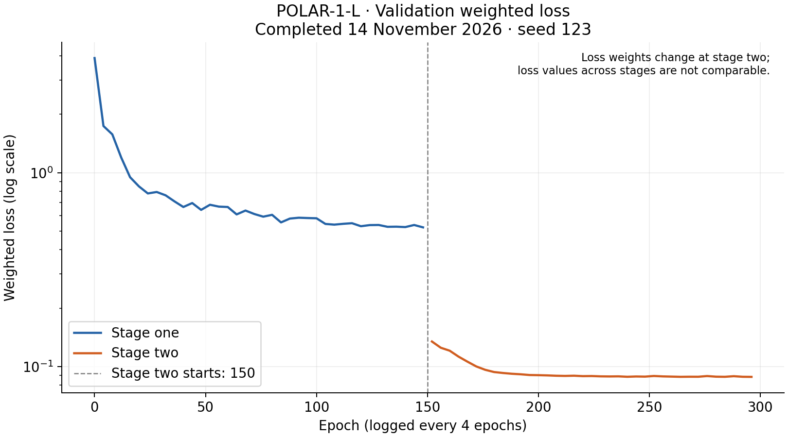
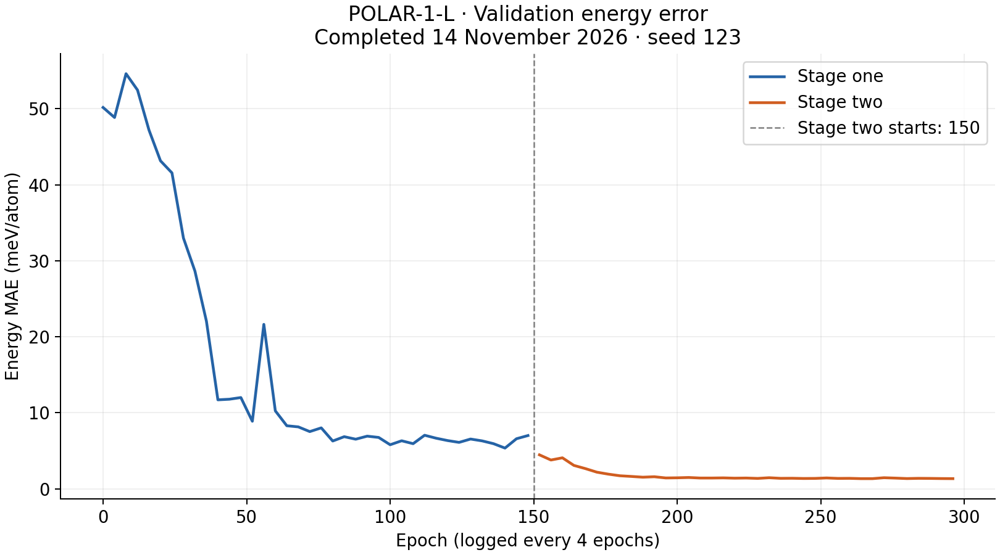
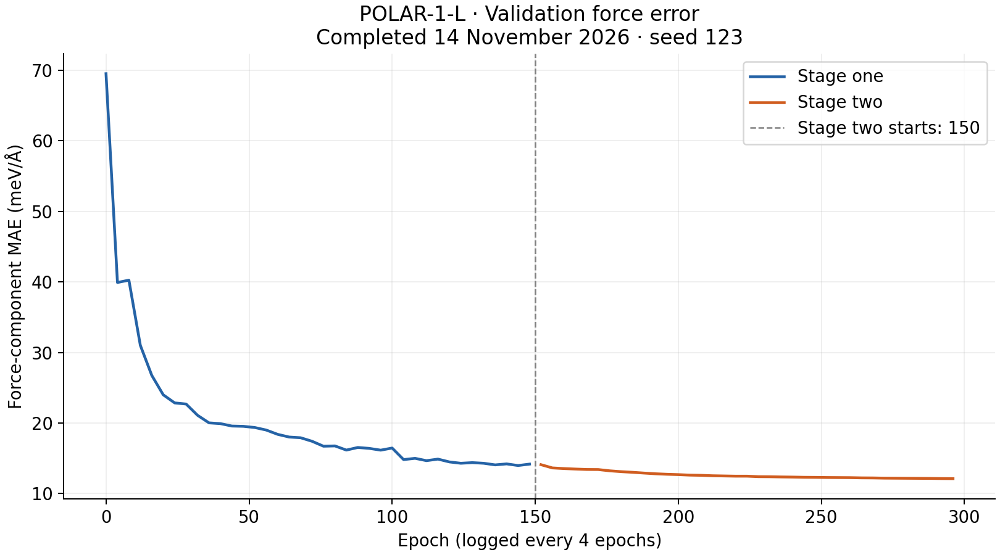

POLAR-1-L completed fine tuning (14 November 2026)
================================================





Latest completed run recorded in the workflow notebook:
`polar1l_wb97m_no_disp_foundation_swa300_20261113T190333_348063+0100`.
Completion: 2026-11-14 04:18:02 +01:00. The plots contain 75 logged
validation measurements from epochs 0–296, with no smoothing or inference.
Energy is per-atom MAE; force is component MAE. Validation contains 1000
structures; these are not the separate 50 held-out evaluation structures.

Stage two starts at epoch 150, changing energy/force weights from 10/1000
to 1000/100 and learning rate from 0.01 to 0.001. Loss magnitudes across
that boundary are not comparable. Both stages use EMA. Final saved-model
validation tables report energy/force MAE 7.0 meV/atom and 14.2 meV/Å for
stage one (epoch 148), versus 1.3 meV/atom and 12.1 meV/Å for stage two
(epoch 296). The final history values retain the log's higher precision.

`validation_history.csv` contains plotted values; `provenance.json` records
the source log and its SHA-256. Regenerate from the workflow directory:

```bash
python visualization/plot_completed_history.py /path/to/run-123.log visualization/polar1l_completed_20261114 --stage-two 150
```

No training or held-out evaluation was launched to generate these figures.
