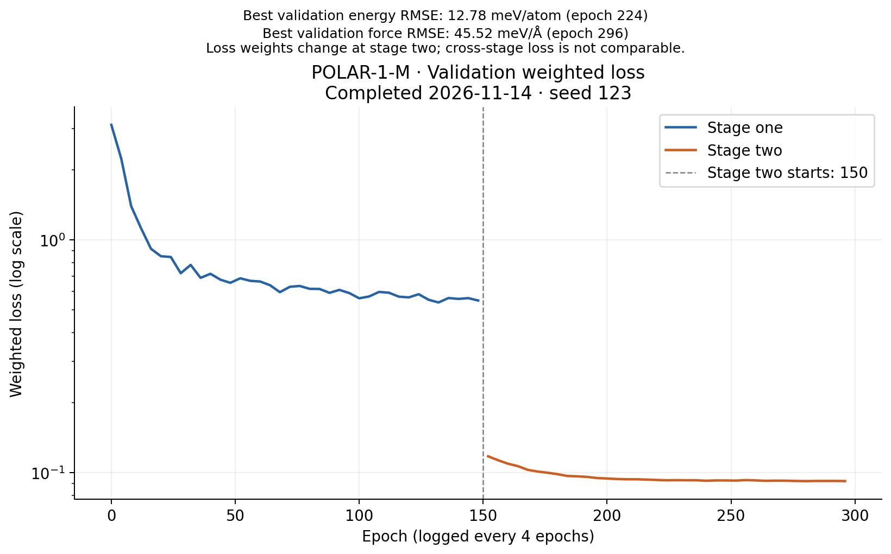
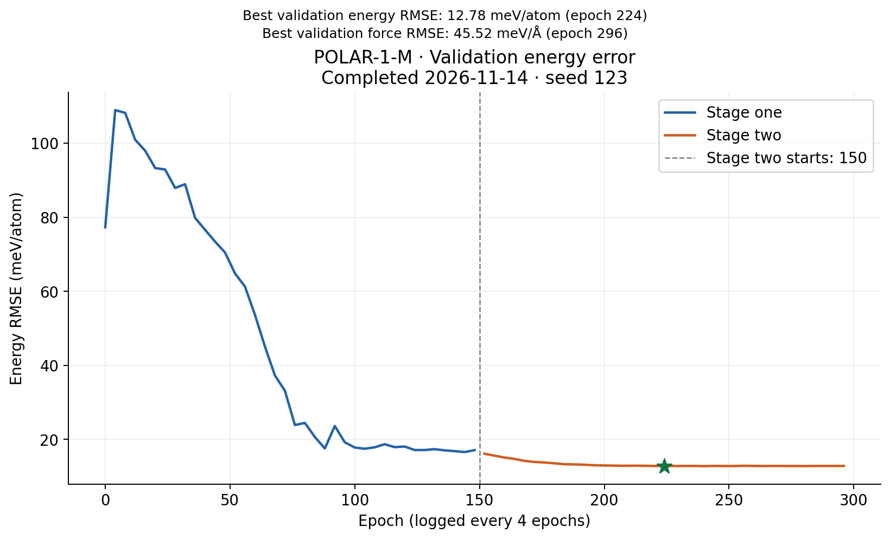
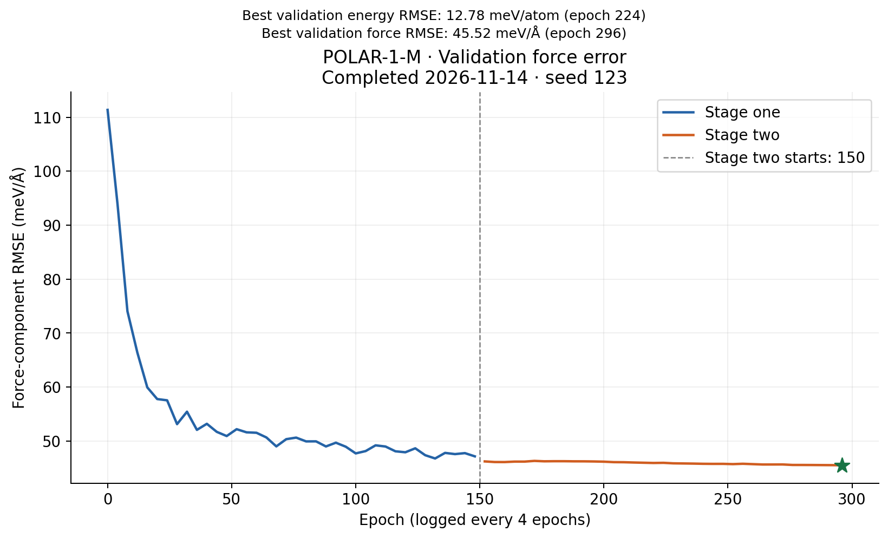

POLAR-1-M validation RMSE history
=======================================





Run: `polar1m_wb97m_no_disp_foundation_swa300_20261113T190333_819276+0100`.

Best logged validation energy RMSE: **12.78 meV/atom**, epoch **224**.
Best logged validation force-component RMSE: **45.52 meV/Å**, epoch **296**.
These independent minima need not belong to the same checkpoint.

All plots annotate both best RMSEs. Error curves show RMSE, replacing the earlier MAE curves.
The CSV contains all 75 validation measurements at epochs 0–296. Metrics come from the
run's JSON-lines results file, matched to logged validation epochs and loss.
Energy RMSE uses per-atom energy residuals; force RMSE uses Cartesian force components.
Both are converted from eV units to meV units. No inference or smoothing was performed.
The initial pre-training evaluation (epoch=null) is excluded from the epoch-history minima.

Stage two starts at epoch150 and changes energy/force weights from10/1000 to1000/100
and learning rate from0.01 to0.001. Loss magnitudes across stages are not comparable.
Validation is the fixed1000-structure split, not the separate50 held-out evaluation structures.
These validation minima do not establish the held-out pressure gate.
Source log/results paths and SHA-256 hashes are recorded in `provenance.json`.

Regenerate from the workflow directory (the run's sibling results directory is required):

```bash
python visualization/plot_completed_history.py /path/to/logs/run-123.log visualization/polar1m_completed_20261114 --stage-two 150
```
