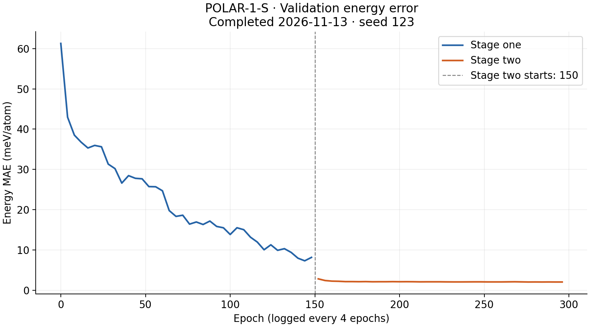

POLAR-1-S completed fine tuning
=====================================





Run: `polar1s_wb97m_no_disp_foundation_swa300_20261113T190312_122175+0100`.

These figures show 75 logged validation measurements, with no smoothing or inference.
Last logged epoch: 296; energy MAE: 2.08 meV/atom;
force-component MAE: 29.45 meV/Å.
Validation contains 1000 structures and excludes the separate 50 held-out evaluation structures.
Stage two starts at epoch150, changing energy/force weights from10/1000 to1000/100
and learning rate from0.01 to0.001; cross-stage loss magnitudes are not comparable.
Both stages use EMA. Completion date appears on each plot.

`validation_history.csv` holds the plotted values; `provenance.json` records the source log and SHA-256.
Regenerate from the workflow directory with:

```bash
python visualization/plot_completed_history.py /path/to/run-123.log visualization/polar1s_completed_20261114 --stage-two 150
```

No training or held-out evaluation was launched.
