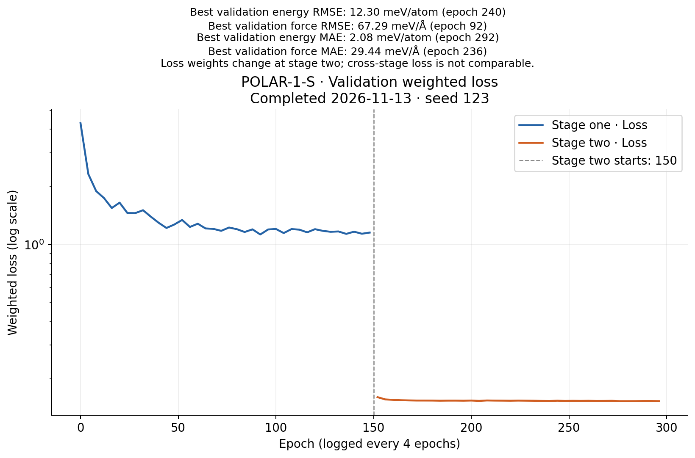
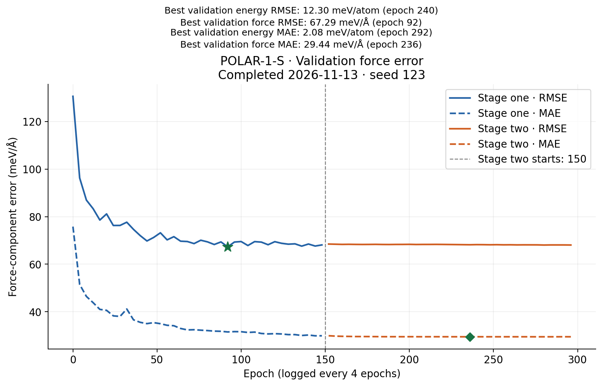

POLAR-1-S validation MAE and RMSE history
===============================================





Run: `polar1s_wb97m_no_disp_foundation_swa300_20261113T190312_122175+0100`.

Best recorded validation metrics:

- best_energy_RMSE: 12.30 meV_per_atom, epoch 240
- best_energy_MAE: 2.08 meV_per_atom, epoch 292
- best_force_component_RMSE: 67.29 meV_per_A, epoch 92
- best_force_component_MAE: 29.44 meV_per_A, epoch 236

Energy and force plots overlay RMSE (solid) and MAE (dashed). Blue/orange denote
stage one/two. Stars mark minimum RMSE and diamonds mark minimum MAE.
All figures annotate the four independent minima and their epochs, which may
refer to different checkpoints. CSV contains all75 recorded validation epochs0–296;
provenance records source log/results paths and SHA-256 hashes. Log loss and MAE
are checked against the JSON-lines results; all plotted metrics use the latter's precision.
Energy errors use per-atom residuals; force errors use Cartesian components.
Values are converted from eV to meV. Initial epoch-null evaluation is excluded.

Stage two starts at epoch150, changing weights10/1000 to1000/100 and LR0.01 to0.001;
cross-stage loss is not comparable. The fixed1000-structure validation split excludes
the50 held-out evaluation structures. No inference or new training was run.

```bash
python visualization/plot_completed_history.py /path/to/logs/run-123.log visualization/polar1s_completed_20261114 --stage-two 150
```
